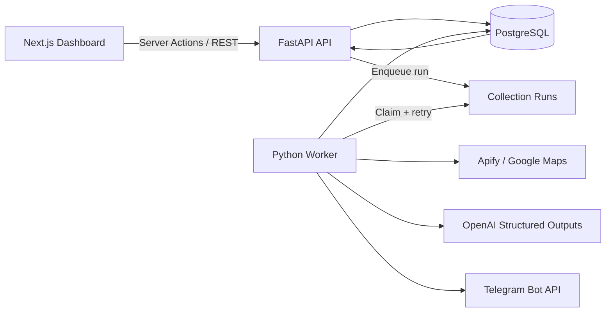

# Basira — Customer Experience Intelligence Platform

Basira is an Arabic-first customer experience intelligence platform for collecting Google Maps reviews, analyzing them with structured AI, tracking operational issues, and presenting reliable metrics in a responsive RTL dashboard.

The platform collects reviews through **Apify**, analyzes each review independently with **OpenAI Structured Outputs**, stores the complete processing history in **PostgreSQL**, and produces one persisted management report per run with optional **Telegram** delivery.

> The original Python application remains available in `app/` and `main.py`. The production-oriented implementation lives in `backend/` and `frontend/`, and legacy SQLite data can be migrated without modifying the source database.

## Key features

- Manage organizations, branches, and branch-specific Google Maps sources.
- Manage employees, including a required `F` or `M` gender value that is never inferred by AI.
- Manage menu categories and items for restaurants and cafés.
- Collect reviews dynamically from active database sources instead of a static input file.
- Normalize and deduplicate reviews with database-level uniqueness constraints.
- Analyze sentiment, issue type, severity, urgency, root cause, and recommended actions.
- Match employee mentions conservatively; nationality alone never identifies an employee.
- Match mentioned products against real menu records.
- Persist explicit states for reviews and collection runs, with safe retries.
- Create, assign, track, and resolve operational issues.
- Generate one idempotent Telegram report per run and record every delivery attempt.
- Display source-backed metrics in an Arabic RTL dashboard with real empty states.
- Protect the backend with an API key and protect the production dashboard server-side.

## Is this an advanced AI system? Is it RAG or LangGraph?

Yes, this is an **advanced, production-oriented AI application architecture**. It is more than a single model call: it includes relational data modeling, a REST API, a background worker, persisted state transitions, deduplication, retry handling, structured AI results, operational reporting, and a management dashboard.

Its precise technical classification is:

| Technology or pattern | Used? | Details |
|---|---:|---|
| OpenAI API | Yes | Uses the official `openai` Python SDK for review analysis. |
| Structured Outputs | Yes | OpenAI results are parsed into a strict Pydantic schema rather than untrusted free-form text. |
| RAG | No | There is currently no document knowledge base, embedding pipeline, vector search, or retrieval step. |
| LangGraph | No | The workflow is implemented with Python services and PostgreSQL-backed states, not an agent graph. |
| OpenAI Agents SDK | No | The current system does not require agent handoffs or an agent-managed tool loop. |
| Vector database | No | Operational entities are retrieved directly from PostgreSQL, which is appropriate for this use case. |

Not using RAG or LangGraph is intentional, not a missing feature. This use case is a **deterministic, auditable AI processing pipeline**, not question answering over a document library. RAG would become useful if the platform needed to search policies, training manuals, or a large historical knowledge base. LangGraph or the OpenAI Agents SDK would become useful if the workflow evolved into multiple autonomous agents, tool selection, human approvals, or complex branching decisions.

## Architecture



### Runtime components

1. **Next.js dashboard**
   - Arabic RTL management interface using the App Router and TypeScript.
   - Reads happen on the server and mutations use Server Actions.
   - The backend API key never reaches the browser.
   - A routing proxy and centralized authorization check protect production access.

2. **FastAPI backend**
   - REST endpoints for CRUD operations, metrics, issue management, and run enqueueing.
   - Pydantic validates API inputs and AI outputs.
   - Every endpoint is protected with `X-API-Key`.

3. **PostgreSQL**
   - The source of truth for organizations, branches, employees, review sources, reviews, analyses, issues, runs, reports, and notification attempts.
   - SQLAlchemy provides the ORM and Alembic manages schema migrations.
   - Unique constraints prevent duplicate reviews and duplicate logical reports.

4. **Database-backed worker**
   - Executes long-running work outside HTTP requests.
   - Claims queued jobs with `SELECT ... FOR UPDATE SKIP LOCKED`.
   - Isolates review-level failures and preserves retryable state.

5. **External integrations**
   - Apify collects Google Maps reviews.
   - OpenAI analyzes one review at a time and returns a validated structure.
   - Telegram receives the final management report.

## Technology stack

### Backend

- Python 3.11–3.13
- FastAPI 0.116
- SQLAlchemy 2
- Alembic
- PostgreSQL with Psycopg 3
- Pydantic 2 and Pydantic Settings
- OpenAI Python SDK 2
- Requests and HTTPX
- Tenacity for external-call retries
- Pytest
- Structured JSON logging

### Frontend

- Next.js 16 App Router
- React 19
- TypeScript 5
- Tailwind CSS 4
- Recharts
- Lucide React
- Locally owned shadcn-style UI components
- pnpm

### Infrastructure

- Docker and Docker Compose
- PostgreSQL 17 in the default Docker setup
- Separate containers for the frontend, API, worker, and database

## Repository structure

```text
.
├── backend/
│   ├── alembic/                  # Database migrations
│   ├── app/
│   │   ├── api/                  # REST endpoints
│   │   ├── core/                 # Configuration, security, and logging
│   │   ├── db/                   # Engine and sessions
│   │   ├── integrations/         # Apify, OpenAI, and Telegram clients
│   │   ├── services/             # Processing, matching, metrics, reports
│   │   └── workers/              # Background run worker
│   ├── scripts/                  # Legacy SQLite migration
│   └── tests/                    # Domain and integration tests
├── frontend/
│   └── src/
│       ├── app/                  # Pages, route handler, and Server Actions
│       ├── components/           # Dashboard components
│       └── lib/                  # API client, types, auth, and helpers
├── app/                          # Preserved legacy application
├── docs/ARCHITECTURE.md
├── docker-compose.yml
└── main.py                       # Legacy entry point
```

## Processing flow

1. An authorized user creates an organization, branches, review sources, and employees.
2. The user enqueues a collection run from the dashboard.
3. The worker claims the run from PostgreSQL.
4. Apify input is built from active branch sources stored in the database.
5. Reviews are normalized and persisted before analysis.
6. Each review is analyzed independently and its success or failure state is saved.
7. Employee and menu mentions are matched against real organization records.
8. Required issues are created and run metrics are updated.
9. One report is generated for the run and optionally delivered through Telegram.
10. The dashboard reads only persisted, source-backed metrics.

## Requirements

The simplest setup requires Docker Desktop. For a manual installation, use:

- Python 3.11–3.13
- Node.js 22+
- pnpm 10+
- PostgreSQL 15+
- An Apify account and a compatible Google Maps reviews actor
- An OpenAI API key
- A Telegram bot token and chat ID if report delivery is enabled

## Environment configuration

For Docker Compose, copy the backend example into the repository root:

```powershell
Copy-Item backend/.env.example .env
```

Configure at least the following values:

```env
ENVIRONMENT=production
APP_API_KEY=replace-with-a-unique-random-value-at-least-24-characters
DATABASE_URL=postgresql+psycopg://cx:cx@postgres:5432/cx_reviews
CORS_ORIGINS=http://localhost:3000

APIFY_TOKEN=
ACTOR_ID=
OPENAI_API_KEY=
OPENAI_MODEL=gpt-4o-mini
TELEGRAM_BOT_TOKEN=
TELEGRAM_CHAT_ID=
DASHBOARD_URL=http://localhost:3000

DASHBOARD_USER=admin
DASHBOARD_PASSWORD=replace-with-a-long-random-password
```

Never commit real credentials. `.env` and `frontend/.env.local` are excluded by `.gitignore`.

## Run with Docker Compose

After configuring `.env`:

```powershell
docker compose up --build
```

Open:

- Dashboard: `http://localhost:3000`
- OpenAPI documentation: `http://localhost:8000/docs`

Docker Compose starts:

- `postgres`: the database.
- `backend`: FastAPI; migrations run during startup.
- `worker`: review collection, AI analysis, and reporting.
- `frontend`: the Next.js dashboard.

Stop the stack with:

```powershell
docker compose down
```

PostgreSQL data remains in the `postgres_data` volume.

## Run locally without Docker

### 1. Backend

```powershell
cd backend
python -m venv .venv
.\.venv\Scripts\Activate.ps1
pip install -r requirements.txt
Copy-Item .env.example .env
alembic upgrade head
uvicorn app.main:app --reload --port 8000
```

For local execution, update `DATABASE_URL` to point to your local PostgreSQL instance.

### 2. Worker

In another terminal, from `backend` with the virtual environment active:

```powershell
python -m app.workers.runner
```

To process one queued run and exit:

```powershell
python -m app.workers.runner --once
```

### 3. Frontend

Create `frontend/.env.local`:

```env
BACKEND_URL=http://127.0.0.1:8000/api/v1
APP_API_KEY=the-same-value-used-by-the-backend
DEFAULT_ORGANIZATION_ID=
DASHBOARD_USER=admin
DASHBOARD_PASSWORD=replace-with-a-long-random-password
```

Then run:

```powershell
cd frontend
corepack enable
pnpm install
pnpm dev
```

## First-time setup

1. Open **Settings** and create the organization.
2. Open **Branches** and add each branch with its real Google Maps URL.
3. Add employees and select `F` or `M` for gender.
4. For restaurants and cafés, add menu categories and items.
5. Confirm that both the backend and worker are running.
6. Open **Run History & Reports** and enqueue a collection run.
7. Monitor reviews, issues, run state, and reports from the dashboard.

## Tests and quality checks

The automated tests do not call paid external services:

```powershell
cd backend
pytest
python -m compileall -q app tests

cd ..\frontend
pnpm lint
pnpm build
```

Coverage includes:

- Review deduplication.
- Employee gender validation (`F` or `M` only).
- Safe employee matching and ambiguity handling.
- Strict AI output validation.
- Matching against real menu entities.
- Sentiment metric reconciliation.
- A full processing run from collection through issue creation and reporting.
- Telegram delivery idempotency and retry handling.

## Migrate the legacy SQLite database

Do not delete `reviews.db`. After creating the target organization and branch in PostgreSQL:

```powershell
cd backend
python scripts/migrate_legacy_sqlite.py ..\reviews.db ORGANIZATION_ID BRANCH_ID
```

The migration script opens the legacy database in read-only mode. Migrated reviews are stored as `PENDING_ANALYSIS` so the new worker can process them.

## Security and privacy

- Reviewer personal-data scraping is disabled when supported by the configured Apify actor.
- `APP_API_KEY` is never exposed to browser-side code.
- Production rejects the default API key and keys shorter than 24 characters.
- Server Actions and the backend proxy recheck dashboard authorization.
- AI output is accepted only after Pydantic validation succeeds.
- Secrets, local databases, virtual environments, dependencies, and build output are excluded from Git.

For a multi-user enterprise deployment, replace the current Basic authentication gate with an identity provider that supports SSO, RBAC, and MFA.

## Additional documentation

See [`docs/ARCHITECTURE.md`](docs/ARCHITECTURE.md) for processing states, reliability boundaries, and metric semantics.
